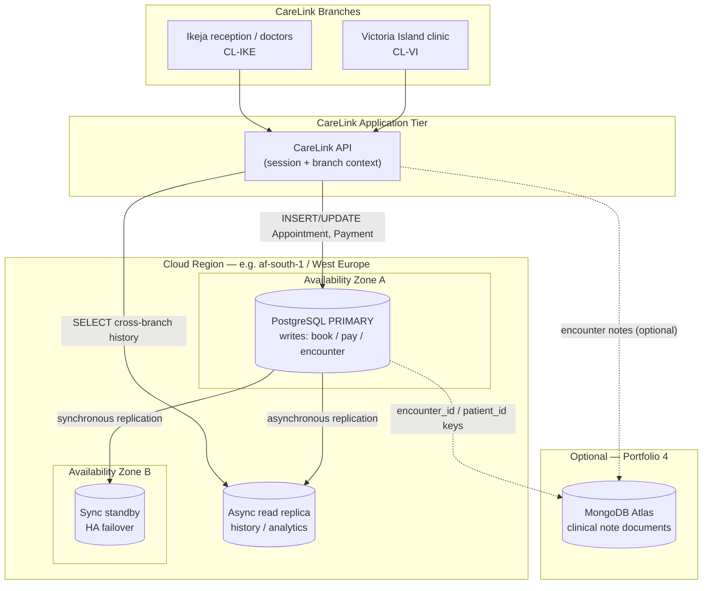

# CareLink Clinic — Distributed & Cloud Architecture

**Document type:** DistributedArchitecture  
**Student:** Chibuzo Miracle (301888687)  
**File:** `Chibuzo_Miracle_DistributedArchitecture.md`  
**Case study:** CareLink Clinic (multi-branch outpatient network)

## 1. Objectives

CareLink operates multiple outpatient branches (seeded as **CareLink Ikeja** `CL-IKE` and **CareLink Victoria Island** `CL-VI`). The distributed design must:

1. Keep **day-of-clinic writes** (booking, check-in, encounter, payment) low-latency and strongly consistent per branch.  
2. Support **cross-branch patient history** without requiring every reception desk to own a full, writable copy of all transactional data.  
3. Survive **single-AZ or single-node failure** without losing booked appointments or completed payments.  
4. Scale as more Lagos-area (or regional) branches are added.

## 2. Architectural approach

**Hybrid: centrally managed PostgreSQL cluster + branch-local affinity via partitioning + regional read replicas.**

| Layer | Technology (realistic) | Role |
|-------|------------------------|------|
| OLTP primary | Amazon RDS for PostgreSQL **or** Azure Database for PostgreSQL Flexible Server | Authoritative CareLink relational schema |
| High availability | Multi-AZ synchronous standby | Automatic failover for clinic continuity |
| Read scale-out | Asynchronous read replicas (same region) | Patient history, manager dashboards, lab queues (read-only) |
| Data locality | PostgreSQL declarative partitioning by `branch_id` | Physical affinity of Appointment / Encounter / Payment rows to a branch partition |
| Optional document store | MongoDB Atlas (linked to Portfolio 4) | Flexible clinical notes / longitudinal timeline documents |
| Application | CareLink API / branch workstations | Routes writes to primary; prefers nearest replica for heavy reads |

This is **not** a fully independent database per branch with multi-master writes. Multi-master would risk conflicting appointment slots (`uq_doctor_slot`) and duplicate payments. CareLink therefore uses a **single primary writer** with HA standby, while partitioning keeps branch data organised for locality, pruning, and future horizontal sharding (e.g. Citus).

## 3. Architecture diagram

## 4. Data placement map (aligned to Portfolio 1 schema)

| Entity group | Tables | Placement rationale |
|--------------|--------|---------------------|
| Global reference | `specialty`, `medication`, `lab_test`, `service` | Small catalogues; fully present on primary and all replicas |
| Shared identity | `patient` | **Global** — a patient may book at Ikeja today and VI next week; identity is not branch-owned |
| Branch-affined staff | `staff`, `branch` | Staff rows carry `branch_id`; catalogues replicated everywhere |
| High-volume operational | `appointment`, `encounter`, `diagnosis`, `prescription`, `lab_order`, `payment` | **Partitioned by `branch_id`** (via appointment/encounter ancestry for child tables, or denormalised `branch_id` where needed) so each branch’s working set is contiguous |

### 4.1 Patient records locality

- **Demographics** (`patient`) live in the shared primary database so any branch can register once and recognise the patient network-wide.  
- **Clinical activity** is stored with branch affinity: appointments always have `branch_id`; encounters inherit locality through `appointment_id`.  
- Cross-branch history queries (Portfolio 2 Q2 style) run against a **read replica**, accepting slightly stale reads (seconds) rather than loading the primary.

### 4.2 Booking across branches

- All booking writes hit the **primary**.  
- Constraint `uq_doctor_slot (doctor_id, scheduled_at)` remains globally enforced — a doctor cannot be double-booked even if two branches somehow schedule the same clinician (locum / transfer edge case).  
- Application passes `branch_id` so the insert lands in the correct partition and reception UI filters “today’s list” by local branch.

## 5. Mapping CareLink operations to the architecture

| Operation | Path | Consistency expectation |
|-----------|------|-------------------------|
| Register patient | Write → primary | Strong (unique `patient_number`) |
| Book / cancel / reschedule appointment | Write → primary (partition by `branch_id`) | Strong (no double-booking) |
| Check-in / complete appointment | Write → primary | Strong |
| Record encounter, diagnosis, prescription, lab order | Write → primary | Strong within the visit transaction (Portfolio 3) |
| Record payment | Write → primary | Strong (no lost or duplicate completed payment) |
| View local daily schedule | Read → primary *or* hot replica | Prefer primary near open of clinic; replica OK mid-day if lag &lt; ~1s |
| Cross-branch patient history | Read → async replica | Eventual (lag monitored) |
| Branch manager revenue summary | Read → async replica | Eventual |
| Failover (AZ A loss) | Promote sync standby in AZ B | Brief RTO; no write acceptance until promote completes |
| Optional clinical notes document | Write → MongoDB Atlas | Document eventual; relational encounter remains source of visit identity |

## 6. Failure and locality scenarios

### 6.1 Branch network partition (WAN blip to cloud)

- Branch workstations cannot reach the primary → **booking and payments pause** (prefer consistency over stale local writes).  
- Cached read-only schedules may still display with a “offline / last synced” banner; new appointments are not accepted locally-only, avoiding split-brain against `uq_doctor_slot`.

### 6.2 AZ failure

- Multi-AZ sync standby is promoted.  
- CareLink API reconnects via DNS / connection string failover.  
- In-flight transactions abort and are retried by the application (Portfolio 3 transaction boundaries remain the unit of retry).

### 6.3 Read replica lag spike

- History screens may show a visit completed 2–5 seconds ago as still “in progress”.  
- Clinical **write** path is unaffected. Managers are warned that dashboards are near-real-time, not instant.

## 7. Evolution path

| Stage | Capability |
|-------|------------|
| Now (this portfolio) | Multi-AZ managed PostgreSQL + partitioning by `branch_id` + async read replicas |
| Growth (many branches) | Introduce Citus / distributed PostgreSQL with `branch_id` as distribution key for operational tables; keep `patient` as reference / co-located dimension |
| Portfolio 4 link | MongoDB Atlas cluster in same cloud region for document notes keyed by `patient_id` / `encounter_id` |

## 8. Summary

CareLink’s distributed architecture centres on a **cloud-managed PostgreSQL primary with multi-AZ HA**, **branch-keyed partitioning** for operational locality, and **async replicas** for cross-branch reads. Consistency is prioritised for booking and money; availability of historical views is prioritised via replicas with bounded lag. This matches outpatient reality: wrong double-booking or lost payment is worse than a briefly delayed history screen.
